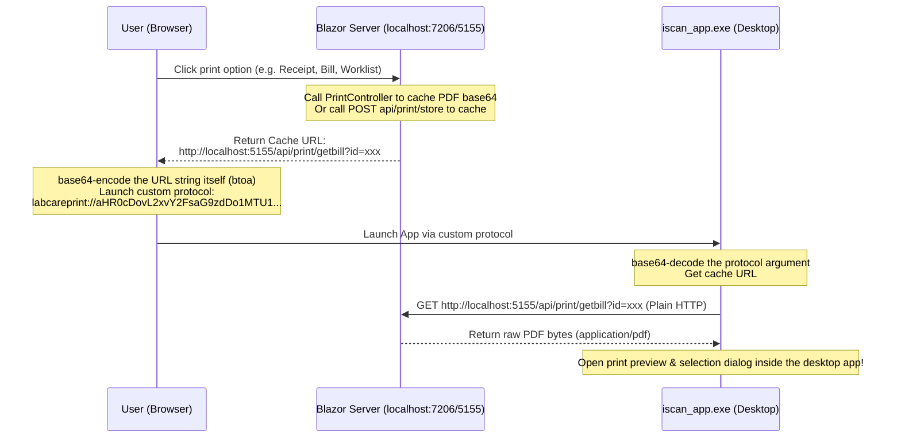

# Desktop Printing Integration Walkthrough (Revised: URL Encoding & Print App Routing)

We have resolved the issue where the print/preview options were opening in browser tabs rather than the desktop print app (`iscan_app.exe`).

---

## 🔍 Root Cause of Browser Tab Fallback
1. Previously, the JavaScript function `sendToLabCarePrint` was intercepting the local cache URL, fetching the raw PDF bytes, converting the bytes into a large base64 string, and trying to pass those bytes through the custom protocol (`labcareprint://`).
2. Because the base64 PDF bytes exceeded **32,000 characters**, it triggered the browser fallback logic, which opened the PDF in a new browser tab.
3. This bypassed `iscan_app.exe` completely, preventing the desktop print preview and selection dialog from appearing.
4. Additionally, legacy print calls in the Blazor pages used the JavaScript function `openBase64Pdf(base64)`, which launched the protocol with the raw PDF base64 bytes directly. For standard and large reports, this exceeded the Windows command-line limit (32,767 characters) and resulted in truncated arguments and **"Invalid PDF Data"** errors inside the app.

---

## 💡 Solution: base64-Encoding the URL & Cache POST Endpoint
Instead of passing base64 PDF bytes through the protocol, we now pass a **base64-encoded localhost URL** pointing to the temporary cache. Since the base64-encoded URL is only about **100 characters**, it is extremely short, never gets truncated, and never triggers a browser fallback.

---

## 🛠️ Changes Implemented

### 1. Updated `PrintController.cs`
- Added an HTTP POST endpoint `/api/print/store` to allow JavaScript-side code to cache raw PDF base64 strings on the server and receive a short HTTP cache URL.
- Updated the GET endpoint `/api/print/getbill` to use `TryGetValue` instead of `TryRemove`. This ensures the PDF can be fetched multiple times if the desktop app retries or executes preview followed by print, while still letting the background 5-minute cleanup handler manage memory.
- [PrintController.cs](file:///c:/Users/iScanSoft1/source/repos/OneTwo-main/OneTwo-main/new-labcare/Controllers/PrintController.cs)

### 2. Updated Javascript in `bill-print.js`
- **`sendToLabCarePrint(payload)`**:
  - If the payload is a URL, it base64-encodes the URL itself (`btoa(payload)`) and launches `labcareprint://<base64_of_URL>`.
  - Because this URL string is only ~100 characters, it never hits the Windows command line limit, and never triggers a browser fallback tab.
- **`openBase64Pdf(base64String)`**:
  - Automatically posts the raw base64 string to `/api/print/store` to cache it on the local server.
  - Upon receiving the cached URL, it base64-encodes it and launches the protocol.
  - This automatically routes all legacy printing operations (due histories, receipts, culture reports, results entry) through the desktop app without truncation.
- [bill-print.js](file:///c:/Users/iScanSoft1/source/repos/OneTwo-main/OneTwo-main/new-labcare/wwwroot/js/bill-print.js)
